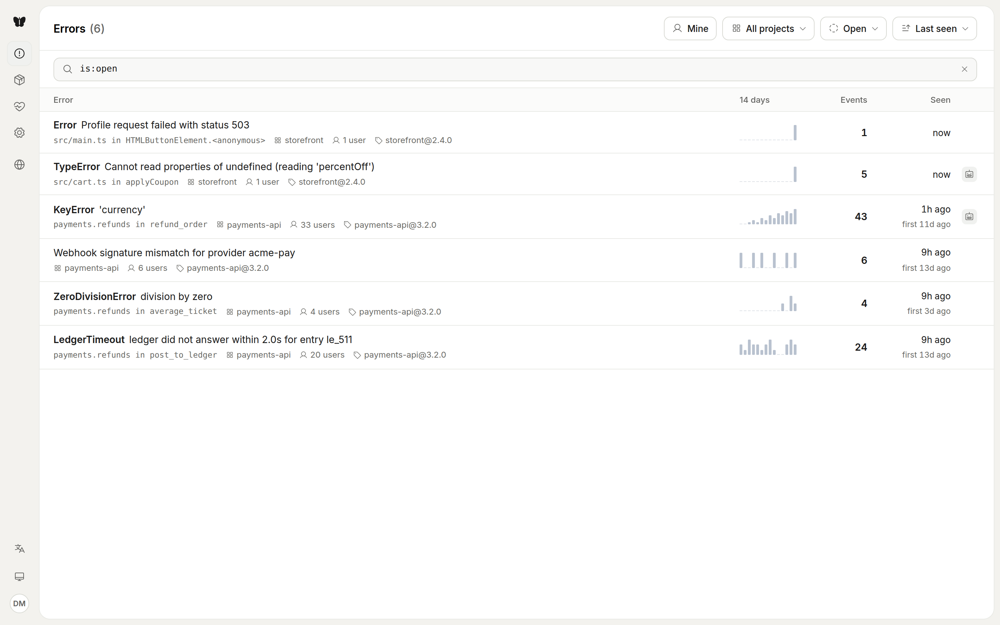
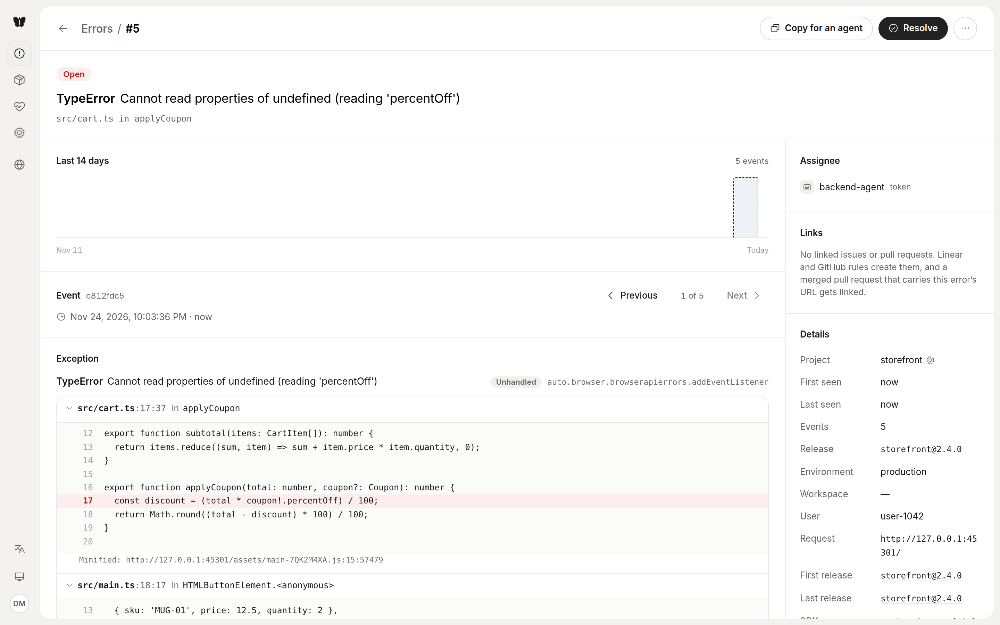

# Mothlog

Mothlog is a self-hosted error tracker that speaks the Sentry protocol: point any Sentry SDK at it by changing only the DSN, and it groups what arrives into issues, translates browser stack traces with your source maps, and alerts you on Slack, Linear, email, GitHub and more. It is a single Go binary with the web UI built in, running on Postgres 16 or on a SQLite file, and it has an MCP server so a coding agent can pick up an error, read its whole context, fix it and mark it resolved.

The name comes from the moth that was found in 1947 stuck in a relay of the Harvard Mark II and taped into its logbook as the "first actual case of bug being found".





## Quick start

You need Docker with Compose.

```sh
git clone https://github.com/intake-es/mothlog.git
cd mothlog
docker compose up
```

This starts Mothlog and a Postgres 16 on http://localhost:8000 and applies the migrations. If the published image (`ghcr.io/intake-es/mothlog:latest`) can't be pulled, Compose builds it from the `Dockerfile`, which takes a few minutes the first time. It is for trying Mothlog out: it signs you in as `dev` without any account, and only listens on `127.0.0.1`.

Leave it running (or start it with `docker compose up -d`) and, in another terminal in the same directory, get the sign-in link that Mothlog writes to its log when it starts; it carries a new key on every start:

```sh
docker compose logs mothlog | grep dev/login
# … "url":"http://localhost:8000/auth/dev/login?key=…"
```

Create a project, from the command line (the UI doesn't create projects); it prints the project's DSN:

```sh
docker compose exec mothlog /mothlog projects create demo
# http://<key>@localhost:8000/1
```

Then put that DSN in a Sentry SDK and raise an error. With Python (`pip install sentry-sdk`):

```python
import sentry_sdk

sentry_sdk.init(dsn="http://<key>@localhost:8000/1", release="demo@1.0.0", environment="production")
1 / 0
```

or in the browser, with `@sentry/browser`:

```js
import * as Sentry from '@sentry/browser';

Sentry.init({ dsn: 'http://<key>@localhost:8000/1', release: 'demo@1.0.0' });
throw new Error('Something broke');
```

The error shows up in the UI within a second. To see browser stack traces in your original source, [upload the source maps](docs/sdks.md#source-maps). `docker compose down` stops everything and `docker compose down -v` also deletes the data. `MOTHLOG_PORT` changes the port and `MOTHLOG_IMAGE` the image; `docker compose -f docker-compose.sqlite.yml up` does the same with SQLite instead of Postgres.

From here:

- [Send errors from your apps](docs/sdks.md): SDK options, releases, release health and source maps (with `sentry-cli` or `curl`).
- [Connect a coding agent](docs/agents.md) to the MCP server.
- [Deploy it](docs/deploy.md) with a real login (GitHub or any OIDC provider).

## What it does

- **Ingestion** of the Sentry envelope protocol: errors, logged exceptions, sessions and cron check-ins, with per-project filters, a per-issue hourly cap, sampling and rate limits. [Ingestion](docs/ingestion.md).
- **Issues** grouped by fingerprint, with regressions, assignees (people or agents), comments, a status history and a search language (`is:open browser:Safari release:1.4.0`). [API and search](docs/api.md).
- **Releases, deploys and environments**: what each release brought, "resolved in the next release", and crash-free sessions and users. [SDKs](docs/sdks.md#releases-deploys-and-environments).
- **Source maps** for browser errors, uploaded with `sentry-cli` or a plain `POST`. [Source maps](docs/sdks.md#source-maps).
- **Cron and uptime monitors**. [Monitors](docs/monitors.md).
- **Alerts** to Slack and Linear by default, and per-project rules to Slack, Linear, email, Discord, Telegram, ntfy, GitHub issues and a signed webhook; two-way sync with Linear and GitHub, and a daily or weekly digest. [Alerts](docs/alerts.md).
- **An MCP server and a REST API** for agents and scripts, with API tokens or OAuth. [Agents](docs/agents.md), [API](docs/api.md).
- **Prometheus metrics**. [Metrics](docs/metrics.md).
- **Import from Sentry**: projects, issues with their latest events, and releases. [Import](docs/import.md).

The UI is in English and Spanish: it follows the browser's language and can be switched from the sidebar. What the server writes (alerts, the Markdown for agents, the MCP, `/llms.txt` and new projects' digests) follows `DEFAULT_LANGUAGE`, `en` by default or `es`.

## Install

- **Docker**: `ghcr.io/intake-es/mothlog`, multi-arch (amd64 and arm64), distroless, without a shell or root, listening on port 8000. There is a tag per version (`ghcr.io/intake-es/mothlog:1.0.0`) and `latest`, the newest one that isn't a pre-release.

  ```sh
  docker run -p 8000:8000 -e DATABASE_URL=postgres://… -e PUBLIC_URL=https://errors.example.com ghcr.io/intake-es/mothlog:latest
  ```

- **Binary**: every release on [GitHub Releases](https://github.com/intake-es/mothlog/releases) has a `.tar.gz` for Linux and macOS, amd64 and arm64, with the UI inside, and `checksums.txt` with their SHA-256:

  ```sh
  v=1.0.0; os=linux; arch=amd64   # or darwin, arm64
  curl -fsSLO https://github.com/intake-es/mothlog/releases/download/v$v/mothlog_${v}_${os}_${arch}.tar.gz
  curl -fsSLO https://github.com/intake-es/mothlog/releases/download/v$v/checksums.txt
  sha256sum --ignore-missing -c checksums.txt   # on macOS: shasum -a 256 --ignore-missing -c checksums.txt
  tar -xzf mothlog_${v}_${os}_${arch}.tar.gz mothlog
  ./mothlog version
  DATABASE_URL=postgres://… PUBLIC_URL=https://errors.example.com ./mothlog
  ```

- **From source**: `docker build -t mothlog .`, or see [CONTRIBUTING.md](CONTRIBUTING.md) to build the binary.

It needs Postgres 16, or nothing with SQLite: `DATABASE_URL=sqlite:///var/lib/mothlog/mothlog.db` keeps everything in one file, for a single instance ([SQLite](docs/sqlite.md)). Migrations run on start.

## Documentation

| | |
|---|---|
| [Configuration](docs/configuration.md) | Every environment variable, signing in (GitHub, OIDC and the development login), sessions and offboarding |
| [Deploy](docs/deploy.md) | Running it in production, memory, secrets and the command line |
| [Command line](docs/cli.md) | `mothlog projects`, `tokens`, `people`, `releases` and `import` |
| [Sending errors](docs/sdks.md) | SDKs, releases, release health, source maps and `sentry-cli` |
| [Ingestion](docs/ingestion.md) | Limits, grouping, tags, filters, sampling, storage and performance |
| [Alerts](docs/alerts.md) | Default alerts, alert rules, the webhook, Linear and GitHub sync, and the digest |
| [Monitors](docs/monitors.md) | Cron and uptime monitors |
| [Agents](docs/agents.md) | The MCP server: tokens, OAuth, clients, tools and the workflow |
| [API](docs/api.md) | The REST API and the search language |
| [Metrics](docs/metrics.md) | `/metrics` for Prometheus, and alerts to start with |
| [Import from Sentry](docs/import.md) | `mothlog import sentry` |
| [SQLite](docs/sqlite.md) | Running on SQLite, its limits and backups, and how it differs from Postgres |

`GET /llms.txt`, public and without a token, describes the service, the API and the MCP for a model.

## Contributing and security

[CONTRIBUTING.md](CONTRIBUTING.md) explains how to build it, run the tests and send a change. To report a vulnerability, see [SECURITY.md](SECURITY.md).

## License

Mothlog is licensed under the [Apache License 2.0](LICENSE).
