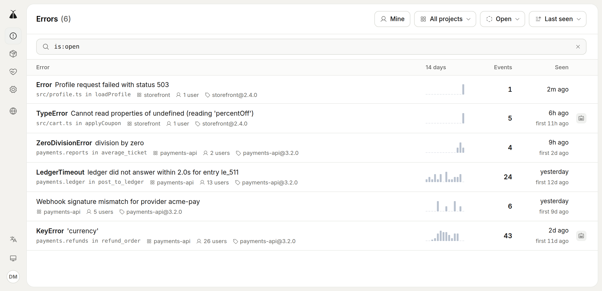
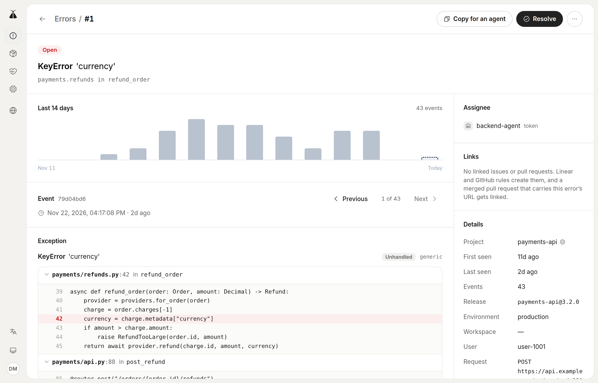

<p align="center">
  <picture>
    <source media="(prefers-color-scheme: dark)" srcset="docs/images/logo-dark.svg">
    
  </picture>
</p>

<h1 align="center">Mothlog</h1>

<p align="center">
  Self-hosted error tracking that speaks the Sentry protocol,<br>
  with an MCP server so your coding agents can fix what breaks.
</p>

<p align="center">
  <a href="#quick-start">Quick start</a> ·
  <a href="#documentation">Docs</a> ·
  <a href="docs/agents.md">Agents</a> ·
  <a href="LICENSE">Apache-2.0</a>
</p>

<p align="center">
  <picture>
    <source media="(prefers-color-scheme: dark)" srcset="docs/images/issues-dark.png">
    
  </picture>
</p>

**Drop-in for Sentry SDKs.** Point any Sentry SDK at Mothlog by changing only the DSN. Errors, releases, release health, cron check-ins and source maps work as they do with Sentry, `sentry-cli` included.

**Built for agents.** An MCP server and a REST API let a coding agent find an error, read its whole context, fix it, leave a comment and mark it resolved. It connects with OAuth or an API token, and everything it does shows in the issue's history.

**Small.** One Go binary with the UI inside, on Postgres 16 or a single SQLite file. At 0.25 vCPU it takes over 200 events per second in under 50 MB of RAM.

## Quick start

You need Docker with Compose.

```sh
git clone https://github.com/intake-es/mothlog.git && cd mothlog
docker compose up -d
docker compose logs mothlog | grep dev/login                # open the sign-in link it prints
docker compose exec mothlog /mothlog projects create demo   # prints the project's DSN
```

Then put the DSN in a Sentry SDK and raise an error:

```python
import sentry_sdk

sentry_sdk.init(dsn="http://<key>@localhost:8000/1", release="demo@1.0.0")
1 / 0
```

It shows up in the UI, on http://localhost:8000, within a second.

This Compose file is for trying Mothlog out: it listens only on `127.0.0.1` and signs you in without an account, with a new key on every start. If the published image can't be pulled, it builds one from the `Dockerfile`, which takes a few minutes the first time. `docker compose -f docker-compose.sqlite.yml up -d` does the same with SQLite, and `docker compose down -v` deletes everything. To run it for real, with a GitHub or OIDC login, see [Deploy](docs/deploy.md).

## Connect a coding agent

With Claude Code:

```sh
claude mcp add --transport http mothlog https://errors.example.com/mcp
```

The first time, the client opens the browser: you sign in with your Mothlog login and choose whether the agent may only read or also comment, assign and change statuses. Clients that can't do OAuth, and agents without a browser, use an API token. [Agents](docs/agents.md) has the details and other clients.

<p align="center">
  <picture>
    <source media="(prefers-color-scheme: dark)" srcset="docs/images/issue-dark.png">
    
  </picture>
</p>

## What it does

| Area | What you get |
|---|---|
| **Issues** | Grouped by fingerprint, with regressions, assignees (people or agents), comments, a status history and a search language: `is:open browser:Safari release:1.4.0`. [API and search](docs/api.md) |
| **Releases** | What each release brought, "resolved in the next release", deploys per environment, and crash-free sessions and users. [SDKs](docs/sdks.md#releases-deploys-and-environments) |
| **Source maps** | Browser stack traces in your original source, uploaded with `sentry-cli` or a plain `POST`. [Source maps](docs/sdks.md#source-maps) |
| **Monitors** | Cron check-ins and uptime checks. [Monitors](docs/monitors.md) |
| **Alerts** | Slack and Linear by default; per-project rules to email, Discord, Telegram, ntfy, GitHub issues and a signed webhook; two-way sync with Linear and GitHub; a daily or weekly digest. [Alerts](docs/alerts.md) |
| **Ingestion** | Errors, logged exceptions, sessions and check-ins, with per-project filters, a per-issue hourly cap, sampling and rate limits. [Ingestion](docs/ingestion.md) |
| **Metrics** | `/metrics` for Prometheus. [Metrics](docs/metrics.md) |
| **Import** | Projects, issues with their latest events, and releases from a Sentry server. [Import](docs/import.md) |

The UI is in English and Spanish, and follows the browser's language. What the server writes (alerts, the Markdown for agents, the MCP, `/llms.txt` and new projects' digests) follows `DEFAULT_LANGUAGE`: `en` by default, or `es`.

## Install

- **Docker:** `ghcr.io/intake-es/mothlog`, multi-arch (amd64 and arm64), distroless, without a shell or root, on port 8000. There is a tag per version (`ghcr.io/intake-es/mothlog:1.0.0`) and `latest`, the newest one that isn't a pre-release.

  ```sh
  docker run -p 8000:8000 -e DATABASE_URL=postgres://… -e PUBLIC_URL=https://errors.example.com ghcr.io/intake-es/mothlog:latest
  ```

- **Binary:** every release on [GitHub Releases](https://github.com/intake-es/mothlog/releases) has a `.tar.gz` for Linux and macOS, amd64 and arm64, with the UI inside, and `checksums.txt` with their SHA-256.

  <details>
  <summary>Download and check it</summary>

  ```sh
  v=1.0.0; os=linux; arch=amd64   # or darwin, arm64
  curl -fsSLO https://github.com/intake-es/mothlog/releases/download/v$v/mothlog_${v}_${os}_${arch}.tar.gz
  curl -fsSLO https://github.com/intake-es/mothlog/releases/download/v$v/checksums.txt
  sha256sum --ignore-missing -c checksums.txt   # on macOS: shasum -a 256 --ignore-missing -c checksums.txt
  tar -xzf mothlog_${v}_${os}_${arch}.tar.gz mothlog
  ./mothlog version
  DATABASE_URL=postgres://… PUBLIC_URL=https://errors.example.com ./mothlog
  ```

  </details>

- **From source:** `docker build -t mothlog .`, or see [CONTRIBUTING.md](CONTRIBUTING.md) to build the binary.

It needs Postgres 16, or nothing with SQLite: `DATABASE_URL=sqlite:///var/lib/mothlog/mothlog.db` keeps everything in one file, for a single instance ([SQLite](docs/sqlite.md)). Migrations run on start.

## Documentation

| Guide | What it covers |
|---|---|
| [Configuration](docs/configuration.md) | Every environment variable, signing in (GitHub, OIDC and the development login), sessions and offboarding |
| [Deploy](docs/deploy.md) | Running it in production, memory, secrets and the command line |
| [Command line](docs/cli.md) | `mothlog projects`, `tokens`, `people`, `releases` and `import` |
| [Sending errors](docs/sdks.md) | SDKs, releases, release health, source maps and `sentry-cli` |
| [Ingestion](docs/ingestion.md) | Limits, grouping, tags, filters, sampling, storage and performance |
| [Alerts](docs/alerts.md) | Default alerts, alert rules, the webhook, Linear and GitHub sync, and the digest |
| [Monitors](docs/monitors.md) | Cron and uptime monitors |
| [Agents](docs/agents.md) | The MCP server: tokens, OAuth, clients, tools and the workflow |
| [API](docs/api.md) | The REST API and the search language |
| [Metrics](docs/metrics.md) | `/metrics` for Prometheus, and alerts to start with |
| [Import from Sentry](docs/import.md) | `mothlog import sentry` |
| [SQLite](docs/sqlite.md) | Running on SQLite, its limits and backups, and how it differs from Postgres |

`GET /llms.txt`, public and without a token, describes the service, the API and the MCP for a model.

## Why "Mothlog"

In 1947, the operators of the Harvard Mark II found a moth stuck in one of its relays and taped it into the logbook as the "first actual case of bug being found".

## Contributing, security and license

[CONTRIBUTING.md](CONTRIBUTING.md) explains how to build it, run the tests and send a change. To report a vulnerability, see [SECURITY.md](SECURITY.md). Mothlog is licensed under the [Apache License 2.0](LICENSE).
